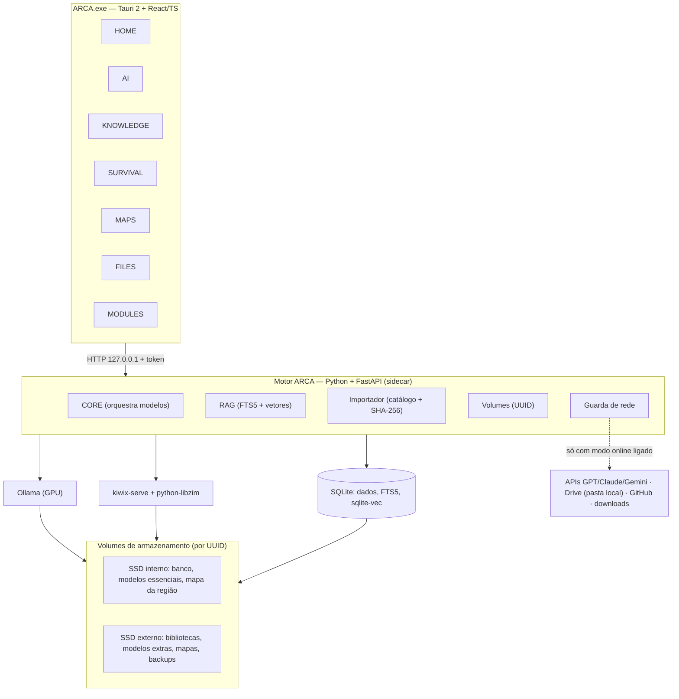

# Arquitetura da ARCA

Aprovada em 2026-11-17. Documento de planejamento completo da Fase 0: https://claude.ai/artifact/X8nPqVicBm1vvLniQ79CKH

## Visão geral

Três processos locais conversam apenas por `127.0.0.1`, com token gerado a cada inicialização:

1. **Interface** — `ARCA.exe` (Tauri 2 + React/TypeScript). Só fala com o motor.
2. **Motor ARCA** — Python 3.12 + FastAPI, iniciado e encerrado pelo Tauri como sidecar. Único componente que acessa modelos, enciclopédias, banco, volumes e, quando permitido, a internet.
3. **Serviços auxiliares** — Ollama (IA local) e `kiwix-serve` (enciclopédias).

## Decisões por camada

| Camada | Escolha | ADR |
| --- | --- | --- |
| Desktop e UI | Tauri 2 + React + TypeScript + Vite | [0001](../adr/0001-desktop-tauri.md) |
| Motor | Python 3.12 + FastAPI, sidecar, PyInstaller onedir | [0002](../adr/0002-motor-python-sidecar.md) |
| Banco e busca | SQLite (WAL) + FTS5 + sqlite-vec | [0003](../adr/0003-sqlite-fts5-sqlite-vec.md) |
| IA local e online | Ollama atrás de `ModelProvider`; APIs online opcionais | [0004](../adr/0004-ia-ollama-model-provider.md) |
| Enciclopédias | Kiwix; Wikipédia não é vetorizada | [0005](../adr/0005-kiwix-enciclopedias.md) |
| Mapas | PMTiles + MapLibre, recursos empacotados | [0006](../adr/0006-mapas-pmtiles.md) |
| Armazenamento | Volumes por UUID, Drive como origem, nunca apagar | [0007](../adr/0007-armazenamento-volumes.md) |

## Princípios

- **Guarda de rede central.** Toda saída de rede passa por `netguard`. Modo padrão: bloqueado. A interface tem CSP que bloqueia URLs externas; fontes e ícones são empacotados.
- **Sem Docker.** No Windows exigiria WSL2 e RAM que o notebook não tem.
- **Um modelo de chat carregado por vez**, descarga por ociosidade (padrão 5 min), orçamento de VRAM/RAM antes de carregar.
- **RAG com referências.** Toda resposta baseada em documentos lista as fontes usadas, com página/trecho.

## Hardware alvo

Acer Nitro V16 · RTX 5060 8 GB VRAM · 8 GB RAM (upgrade para 24 GB planejado, portão da Fase 2) · SSD 512 GB · Windows 11 · SSD externo 2 TB futuro.

| Perfil de modelo | Porte | Tamanho aprox. (Q4) |
| --- | --- | --- |
| Rápido | 3–4B | ~2–3 GB |
| Padrão | 7–9B | ~5–6 GB |
| Profundo | 12–14B | ~8–10 GB (parte na RAM) |
| Embeddings | 0,3–0,6B | ~0,3–1,2 GB |

Famílias e versões exatas serão escolhidas na Fase 2, com medições reais no notebook.

## Documentos relacionados

- [ARMAZENAMENTO.md](ARMAZENAMENTO.md) — volumes, caminhos, migração, backup, estimativas.
- [DESIGN.md](DESIGN.md) — interface e experiência.
- [Roadmap e fases](../fases/README.md).
