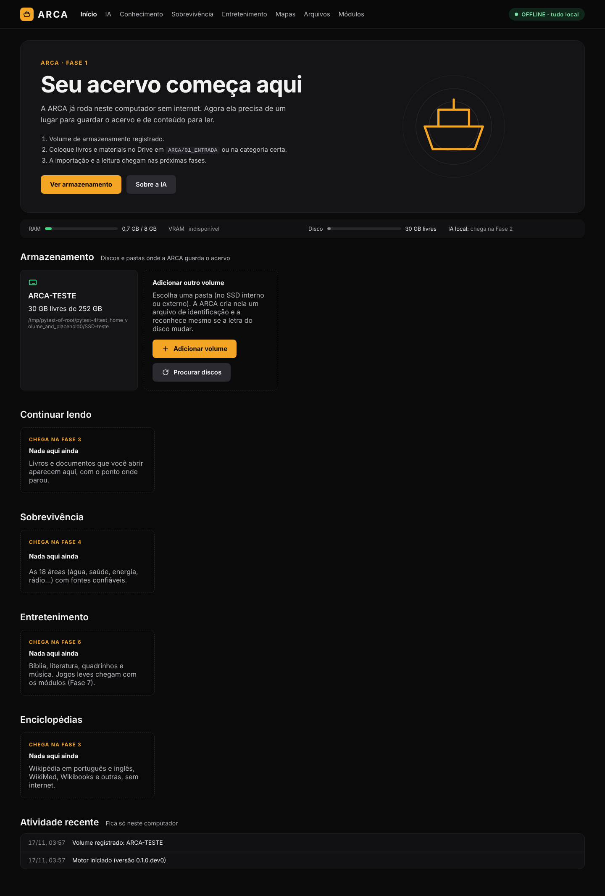
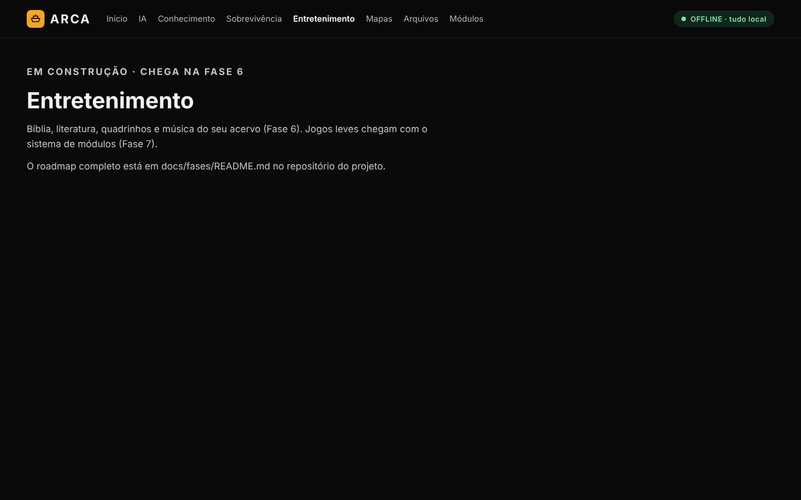

# 2026-11-17 — Fase 1 (CORE) — testes executados na sessão de IA

- **Máquina:** container Linux da sessão do Claude (`Linux 6.18.44`), Python 3.13.18, Node 22.23.4, Chromium (Playwright)
- **Data:** 2026-11-17T07:00Z
- **Branch:** `feat/fase-1-core`
- **Limitação do ambiente:** instalação de pacotes (pip/npm/crates) bloqueada. Por isso FastAPI, uvicorn, Vite, TypeScript types e crates do Tauri **não** estavam disponíveis.

## 1. Motor — `cd engine && python3 -m pytest -q -rs`

```
..................................                                       [100%]
=========================== short test summary info ============================
SKIPPED [1] tests/test_api.py:5: could not import 'fastapi': No module named 'fastapi'
34 passed, 1 skipped in 1.15s
```

Cobertura: pastas por SO, configurações (escrita atômica, chaves desconhecidas preservadas), migrações SQLite (WAL, idempotência, banco mais novo recusado, restrições), histórico, volumes (marcador único, URI segura, volume desconectado, volume reencontrado em outro local, espaço livre), guarda de rede (loopback liberado, externo bloqueado, lista permitida com curinga, só http/https, redirecionamento para host bloqueado interrompido, query string fora do log), dados do sistema (RAM/disco reais, VRAM com motivo quando ausente, parser do nvidia-smi), token, camada de serviço.

**Pulado:** `test_api.py` (camada HTTP FastAPI: 401 sem token, CORS da janela Tauri, rotas). Precisa rodar no notebook após `scripts\setup.ps1`.

## 2. Interface — `NODE_PATH=… python3 -m pytest tests/e2e -q`

```
.                                                                        [100%]
1 passed in 1.25s
```

Interface compilada com esbuild (`scripts/ui-preview/build.mjs`) e servida por `scripts/ui-preview/server.py`, que usa a lógica real do motor sem FastAPI. Verificado no Chromium:

- tela inicial carrega com medidor de RAM e selo OFFLINE;
- registrar volume pelo formulário cria `.arca-volume.json` e mostra o card;
- histórico mostra "Volume registrado";
- IA e Entretenimento mostram "CHEGA NA FASE 2" e "CHEGA NA FASE 6";
- nenhum erro de JavaScript;
- **nenhuma requisição para fora de 127.0.0.1**.





## 3. Shell Tauri

- `rustfmt --check src-tauri/src/main.rs`: OK (sintaxe válida).
- **Não compilado** (crates indisponíveis).

## Pendente no notebook (critérios da Fase 1)

| Critério | Como verificar | Situação |
| --- | --- | --- |
| 1. App abre com Wi-Fi desligado e mostra RAM, VRAM e disco reais | `scripts\dev.ps1` com Wi-Fi desligado | Não testado |
| 2. Fechar o app encerra o motor | Gerenciador de Tarefas após fechar: nenhum `python`/`arca-engine` | Não testado |
| 3. Requisição sem token é recusada | `pytest` no notebook (`test_api.py`) | Não testado |
| 4. netguard bloqueia e registra | Coberto pelos testes do motor | **Passou** (sessão) |
| 5. Volume em pendrive: disponível; removido: indisponível | Registrar pasta no pendrive, remover, "Procurar discos" | Simulado em teste; real não testado |
| 6. Testes automatizados com saída registrada | Este arquivo | **Passou** (sessão); repetir no notebook |
