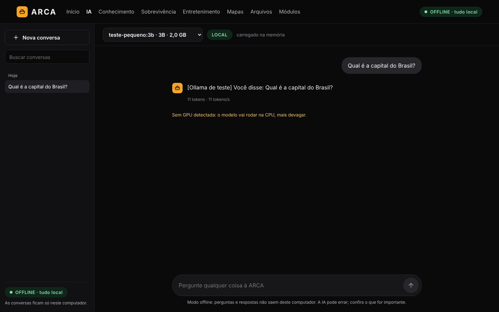
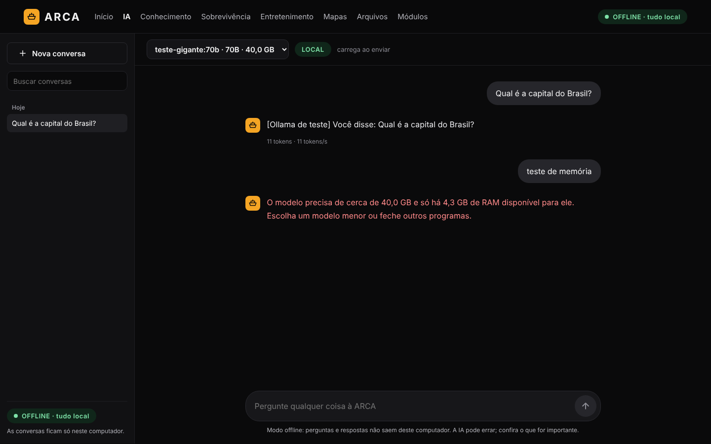

# 2026-11-17 — Fase 2A (IA local) — testes executados na sessão de IA

- **Máquina:** container Linux da sessão do Claude, Python 3.13.18, Node 22.23.4, Chromium (Playwright). Sem GPU.
- **Branch:** `feat/fase-2-ai` (sobre `feat/fase-1-core`)
- **Ollama:** **falso** (`engine/tests/fakes/fake_ollama.py`), que imita a API HTTP do Ollama e responde "[Ollama de teste] Você disse: …". Nenhum modelo real foi executado.

## 1. Motor — `cd engine && python3 -m pytest -q -rs`

```
.................................................                        [100%]
=========================== short test summary info ============================
SKIPPED [1] tests/test_api.py:5: could not import 'fastapi': No module named 'fastapi'
49 passed, 1 skipped in 8.09s
```

Novos nesta etapa (15): provedor Ollama (status, modelos, streaming, estatísticas, carregar/descarregar, modelo inexistente, Ollama fechado, Ollama remoto bloqueado pelo netguard), orçamento de memória (GPU, parcial, recusado, só CPU) e chat (gravação, histórico e prompt de sistema, um modelo por vez, modelo grande recusado sem criar conversa, aviso de modo parcial, texto vazio, sem modelo, Ollama fechado, parar no meio guarda o parcial, apagar conversa).

## 2. Interface — `NODE_PATH=… python3 -m pytest tests/e2e -q`

```
..                                                                       [100%]
2 passed in 3.24s
```

`test_chat_with_local_model`: escolhe modelo, envia pergunta, resposta chega em streaming com tokens/s, conversa aparece na lateral, modelo de 40 GB é recusado com explicação, nova conversa e reabertura pelo histórico. Sem erros de JavaScript; nenhuma requisição para fora de 127.0.0.1.





## Pendente no notebook

| Critério da Fase 2 | Como verificar | Situação |
| --- | --- | --- |
| 1. Resposta em streaming com modelo real, offline, salva | Instalar Ollama, baixar um modelo, Wi-Fi desligado, conversar | Não testado |
| 2. Segundo modelo descarrega o primeiro | Trocar de modelo e ver `ollama ps` | Testado com Ollama falso |
| 3. Modelo grande recusado com explicação | Escolher modelo maior que VRAM + RAM | Testado com Ollama falso |
| 4. Sem Ollama, a tela explica o que fazer | Fechar o Ollama e abrir a aba IA | Testado (motor); visual no notebook |
| 5. Nada online sai do computador | netguard + Firewall | Testado (motor) |
| 6. Testes registrados | Este arquivo | **Passou** (sessão) |

## 3. Notebook do usuário (Windows 11) — `scripts\setup.ps1`

- **Máquina:** Acer Nitro V16 do usuário, Windows 11, Python 3.12 (rodas `cp312-win_amd64`), branch `feat/fase-2-ai`
- **Data:** 2026-11-17 (saída enviada pelo usuário)

```
==> Testes do motor
.......................................................                                [100%]
===================================== warnings summary ======================================
.venv\Lib\site-packages\fastapi\testclient.py:1
  ... StarletteDeprecationWarning: Using `httpx` with `starlette.testclient` is deprecated; install `httpx2` instead.
55 passed, 1 warning in 23.44s
```

Primeira execução **com FastAPI**: os 6 testes de `test_api.py` passaram, inclusive "requisição sem token = 401" (critério 3 da Fase 1), CORS da janela Tauri e streaming de `/ai/chat`. O aviso é de uma dependência (Starlette) e não afeta o funcionamento.

`scripts\dev.ps1` parou em `cargo metadata ... program not found`: Rust ainda não instalado ou PowerShell aberto antes da instalação. O script agora verifica isso e explica o que fazer.
